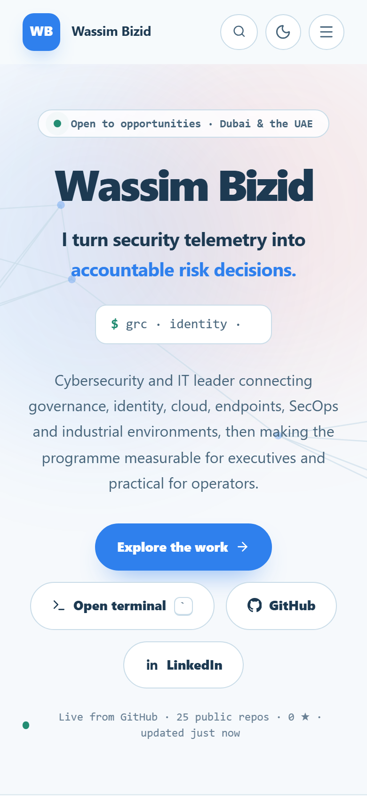

## > whoami

I lead cybersecurity and GRC programmes that turn security telemetry into accountable risk decisions: governance and
audit readiness, identity and Zero Trust in Microsoft Entra ID, endpoint hardening, SecOps, and AI governance under
ISO/IEC 42001. Fifteen years across banking, telecoms, consulting, pharmaceuticals, manufacturing and real estate.
Based between Dubai and Montréal.

## > open ~/portfolio

  
  

23 anonymised case studies with search and topic filters, a `Ctrl K` command palette, a built-in terminal
(press the backtick key), live GitHub stats, light and dark themes. Source:
[wassim-bizid-portfolio](https://github.com/bizidwassim-design/wassim-bizid-portfolio).

## > ls ~/flagship

Sixteen projects, written from scratch, MIT licensed, fictional data only, each with CI and a security policy.
Full index: [cybersecurity-portfolio](https://github.com/bizidwassim-design/cybersecurity-portfolio).

| Theme | Projects |
|-------|----------|
| **Risk and governance** | [application-risk-assessment-template](https://github.com/bizidwassim-design/application-risk-assessment-template) · [risk-treatment-plan-generator](https://github.com/bizidwassim-design/risk-treatment-plan-generator) · [vendor-risk-assessment-template](https://github.com/bizidwassim-design/vendor-risk-assessment-template) · [cybersecurity-raci-library](https://github.com/bizidwassim-design/cybersecurity-raci-library) |
| **Compliance and audit** | [iso27001-iso42001-toolkit](https://github.com/bizidwassim-design/iso27001-iso42001-toolkit) · [grc-control-crosswalk](https://github.com/bizidwassim-design/grc-control-crosswalk) · [control-evidence-collector](https://github.com/bizidwassim-design/control-evidence-collector) · [policy-as-code-starter](https://github.com/bizidwassim-design/policy-as-code-starter) |
| **AI governance** | [ai-risk-assessment-template](https://github.com/bizidwassim-design/ai-risk-assessment-template) · [threat-modeling-toolkit](https://github.com/bizidwassim-design/threat-modeling-toolkit) |
| **Detection and response** | [soc-detection-playbooks](https://github.com/bizidwassim-design/soc-detection-playbooks) · [incident-response-playbooks](https://github.com/bizidwassim-design/incident-response-playbooks) · [soc-maturity-assessment](https://github.com/bizidwassim-design/soc-maturity-assessment) |
| **Executive reporting** | [ciso-executive-dashboard](https://github.com/bizidwassim-design/ciso-executive-dashboard) · [security-metrics-library](https://github.com/bizidwassim-design/security-metrics-library) |
| **Automation** | [public-scripts](https://github.com/bizidwassim-design/public-scripts): 121 PowerShell, KQL and Python scripts for identity, Microsoft 365, Defender and endpoint operations |

Live demos: [CISO executive dashboard](https://bizidwassim-design.github.io/ciso-executive-dashboard/) ·
[SOC maturity self-assessment](https://bizidwassim-design.github.io/soc-maturity-assessment/)

## > cat ~/focus

| | |
|---|---|
| **Frameworks** | ISO/IEC 27001:2022 · ISO/IEC 42001 · NIST CSF 2.0 · CIS Controls v8 · SOC 2 · MITRE ATT&CK · Zero Trust |
| **Platforms** | Microsoft Entra ID and Conditional Access · Defender XDR · Purview · Active Directory · Sentinel and KQL |
| **Certifications** | CISSP · CISM · Azure Security Engineer Associate · ITIL Foundation · RHCSA · VMware VCP |

## > contact

[LinkedIn](https://www.linkedin.com/in/wassim-bizid/) · [Book a 30-minute call](https://calendly.com/letstalk-today/30min) ·
[brainfortsecurity.com](https://www.brainfortsecurity.com/)

Français : responsable cybersécurité et GRC. Portfolio, projets open source GRC/SOC et certifications ci-dessus.
