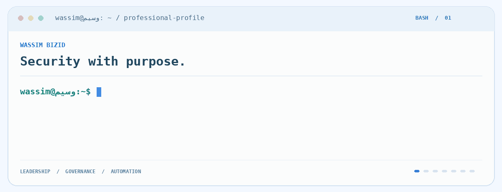
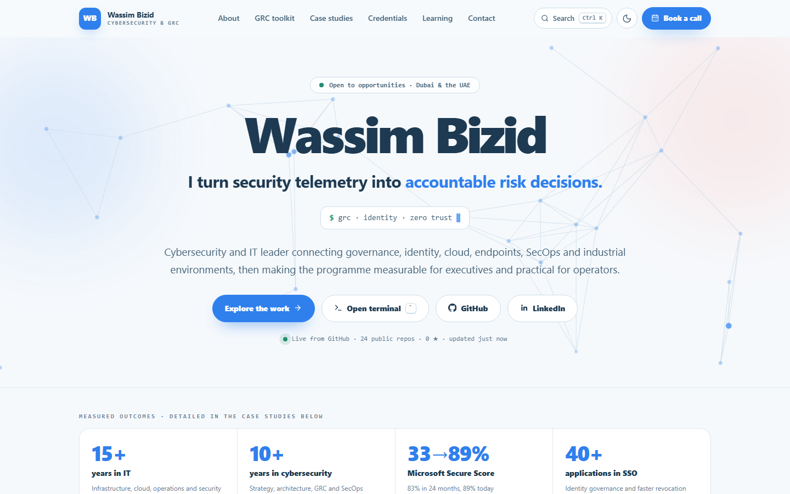
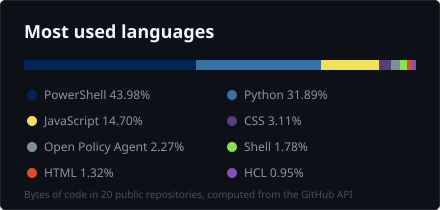

<div align="center">

<a href="https://bizidwassim-design.github.io/wassim-bizid-portfolio/">
  
</a>

<br>

[](https://bizidwassim-design.github.io/wassim-bizid-portfolio/)
[](https://www.linkedin.com/in/wassim-bizid/)
[](https://calendly.com/letstalk-today/30min)
[](https://github.com/bizidwassim-design?tab=repositories)

</div>

---

### `> whoami`

**GRC Manager and cybersecurity leader.** I run security programmes that turn telemetry into accountable risk decisions: governance and audit readiness, identity and Zero Trust in Microsoft Entra ID, endpoint hardening, security operations, and AI governance under ISO/IEC 42001. Fifteen years across banking, telecoms, consulting, pharmaceuticals, manufacturing and real estate, most of it making security measurable for executives and practical for operators. Most recently I led a team of eight, a USD 286k security budget and around fifteen vendors, and reported cyber risk to the board.

```
Education    Executive Mini-MBA, McGill Executive Institute
Certs        CISSP  |  CISM  |  Azure Security Engineer Associate  |  ITIL Foundation  |  RHCSA  |  VMware VCP-DCV  |  ISO/IEC 42001 (in progress)
Focus        GRC and audit readiness  ·  Identity and Zero Trust  ·  Microsoft security  ·  SecOps automation  ·  AI governance
Location     Dubai 🇦🇪 and Montréal 🇨🇦   ·   English, French and Arabic
```

---

### `> open ~/portfolio`

<a href="https://bizidwassim-design.github.io/wassim-bizid-portfolio/">
  
</a>

<div align="center">

**[bizidwassim-design.github.io/wassim-bizid-portfolio](https://bizidwassim-design.github.io/wassim-bizid-portfolio/)** · the same profile as a site, light and dark, installable and offline

</div>

| Feature | What it does |
|:--------|:-------------|
| **GRC coverage map** | Seven GRC domains, each pointing at the case studies and the open-source projects that demonstrate it. |
| **Case-study explorer** | 23 anonymised case studies with search, twelve topic filters, sort, grid or list, and deep links such as `#project-23`. Opens on GRC and risk. |
| **Live numbers** | Public repositories, stars and last push read from the GitHub API, refreshed every 30 minutes. |
| **`Ctrl K` palette and a terminal** | Jump to any section, project or link. Or press `` ` `` and type `help`, `ls projects`, `open 20`, `skills`, `neofetch`. |
| **Credentials with evidence** | Certifications and training records, with the certificate images (identifiers redacted). |
| **No backend** | Plain HTML, CSS and JavaScript, strict Content-Security-Policy, service worker for offline use. |

---

### `> ls ~/flagship`

Every project below is original work, MIT licensed, with fictional data only, CI and a security policy.
Full index: [cybersecurity-portfolio](https://github.com/bizidwassim-design/cybersecurity-portfolio).

**📋  Compliance and frameworks**

| Project | What it does |
|:--------|:-------------|
| [**UAE IA Compliance Matrix**](https://github.com/bizidwassim-design/uae-ia-compliance-matrix) 🟢 live | Compliance matrix for the UAE Information Assurance Standard: 15 control families with status, owner, evidence and gaps, a compliance score, and mappings to ISO/IEC 27001:2022 and NIST CSF 2.0. Import your own control list from CSV. One static page on GitHub Pages. |
| [**ISO 27001 ISMS Lab**](https://github.com/bizidwassim-design/iso27001-isms-lab) | A complete, fictional ISO/IEC 27001:2022 ISMS cycle for a UAE logistics company: context, risk assessment, Statement of Applicability, internal audit and management review, with a validator proving all 93 Annex A controls are covered. A training lab, not a certification claim. |
| [**ISO 27001 and ISO 42001 Toolkit**](https://github.com/bizidwassim-design/iso27001-iso42001-toolkit) | Checklists, six policy templates, a Statement of Applicability covering both Annex A sets, risk treatment plan, RACI, AI system impact assessment, audit evidence list and a four-phase getting-started guide. |
| [**GRC Control Crosswalk**](https://github.com/bizidwassim-design/grc-control-crosswalk) 🟢 live | The 93 ISO 27001:2022 Annex A controls mapped to NIST CSF 2.0, CIS Controls v8, ISO 42001 and SOC 2, with UAE IAR, DESC ISR, UAE PDPL, PCI DSS v4.0.1, NIST SP 800-53 and ISO 22301 overlays; an interactive explorer plus Excel, CSV and YAML. |
| [**Control Evidence Collector**](https://github.com/bizidwassim-design/control-evidence-collector) | Read-only collectors for Windows, Linux, Microsoft 365 and cloud that produce hashed, timestamped JSON evidence for ISO 27001 and CIS v8 controls, with a verification manifest. |
| [**Policy-as-Code Starter**](https://github.com/bizidwassim-design/policy-as-code-starter) | OPA/Rego policies with tests for Kubernetes and Terraform, Checkov custom policies, Sentinel examples and a policy-to-control mapping. |

**🎯  Risk and governance**

| Project | What it does |
|:--------|:-------------|
| [**Application Risk Assessment Template**](https://github.com/bizidwassim-design/application-risk-assessment-template) | Excel workbook with a 5×5 likelihood-and-impact method: inventory, risk register with automatic rating, dashboard and heat map, aligned with ISO 27001, NIST CSF 2.0 and ISO 42001. |
| [**Risk Treatment Plan Generator**](https://github.com/bizidwassim-design/risk-treatment-plan-generator) | Python CLI that turns a risk register into a prioritised, wave-based treatment plan with quick wins, owner workload and Markdown, CSV, Excel and Mermaid outputs. |
| [**Vendor Risk Assessment (TPRM)**](https://github.com/bizidwassim-design/vendor-risk-assessment-template) 🟢 live | Third-party risk management as a workbook and as a web app: vendor tiering by inherent risk, a 60-question weighted questionnaire, residual rating, contract-clause checklist per tier and a dashboard. |
| [**AI Risk Assessment Template**](https://github.com/bizidwassim-design/ai-risk-assessment-template) | Assess AI system risks (bias, transparency, drift, privacy, security, safety) with ISO/IEC 42001 mapping and an EU AI Act quick classifier. |
| [**Threat Modeling Toolkit**](https://github.com/bizidwassim-design/threat-modeling-toolkit) | STRIDE, PASTA and LINDDUN templates, a worked example, and a generator that turns a YAML data-flow model into a STRIDE-per-element threat table mapped to OWASP ASVS and ISO 27001. |
| [**Cybersecurity RACI Library**](https://github.com/bizidwassim-design/cybersecurity-raci-library) | Twelve validated RACI matrices for core security processes with clause references, exported to Markdown and Excel. |

**📊  Executive reporting**

| Project | What it does |
|:--------|:-------------|
| [**Executive Risk Pack**](https://github.com/bizidwassim-design/executive-risk-pack) | Quarterly board cyber-risk pack generated from CSV and YAML: one-page summary, NIST CSF 2.0 posture against target, top-ten risks with heat map, key risk indicators, regulatory calendar and the decisions the board is asked to take. |
| [**CISO Executive Dashboard**](https://github.com/bizidwassim-design/ciso-executive-dashboard) 🟢 live | Single-page board view: KPIs, NIST CSF 2.0 maturity radar, risk and incident trends, vulnerability SLA, compliance progress, top risks, roadmap and budget. Edit one data file. |
| [**Security Metrics Library**](https://github.com/bizidwassim-design/security-metrics-library) | Forty-plus metrics with definitions, formulas, sources and framework references; generated catalogue, board pack, dashboard wireframes and a trend-report generator. |
| [**SOC Maturity Assessment**](https://github.com/bizidwassim-design/soc-maturity-assessment) 🟢 live | Fifty questions across six SOC domains on five maturity levels, radar chart, ranked gap list and a next step for every gap. |

**🔎  Detection and response**

| Project | What it does |
|:--------|:-------------|
| [**SOC Detection Rules and Playbooks**](https://github.com/bizidwassim-design/soc-detection-playbooks) | Sigma rules across a ransomware kill chain, validated in CI, six analyst playbooks, MITRE ATT&CK mapping and a Navigator layer. |
| [**Incident Response Playbooks Pack**](https://github.com/bizidwassim-design/incident-response-playbooks) | Ten incident-manager playbooks (data breach, insider threat, supply chain, DDoS, AI incident and more) with severity matrix, communication templates, records, a tabletop kit, and field notes on automated isolation and a lightweight SOAR. |

**⚙️  Automation**

| Project | What it does |
|:--------|:-------------|
| [**Public Scripts**](https://github.com/bizidwassim-design/public-scripts) | 121 sanitised PowerShell, KQL and Python scripts for identity and security operations, documented and secret-scanned in CI. The library is listed below. |

> 🟢 live: [Control crosswalk](https://bizidwassim-design.github.io/grc-control-crosswalk/) · [Vendor risk (TPRM)](https://bizidwassim-design.github.io/vendor-risk-assessment-template/) · [UAE IA matrix](https://bizidwassim-design.github.io/uae-ia-compliance-matrix/) · [CISO dashboard](https://bizidwassim-design.github.io/ciso-executive-dashboard/) · [SOC maturity](https://bizidwassim-design.github.io/soc-maturity-assessment/)

---

### `> ls ~/scripts`

The script library: 121 scripts I wrote for day-to-day identity, endpoint and Microsoft 365 operations, sanitised and published in [public-scripts](https://github.com/bizidwassim-design/public-scripts). Each one states what it changes and what it needs. [Browse the catalogue](https://github.com/bizidwassim-design/public-scripts/blob/main/docs/catalogue.md).

| Category | Scripts | Typical jobs |
|:---------|--------:|:-------------|
| [Active Directory](https://github.com/bizidwassim-design/public-scripts/tree/main/scripts/active-directory) | 42 | Inactive accounts, LAPS coverage, privileged group matrix, password expiry, manager and owner attributes, HR-to-AD sync, DHCP reservations |
| [Endpoint](https://github.com/bizidwassim-design/public-scripts/tree/main/scripts/endpoint) | 28 | Devices without EDR or RMM agent, Defender behaviour monitoring, local admin accounts, scheduled tasks on servers, silent installs and removals |
| [Entra ID](https://github.com/bizidwassim-design/public-scripts/tree/main/scripts/entra-id) | 12 | Stale guests and devices, foreign sign-ins, per-user MFA to Conditional Access, licence reports, disabled users still licensed |
| [Compliance audits](https://github.com/bizidwassim-design/public-scripts/tree/main/scripts/compliance-audits) | 10 | Weekly user audit, computers with a disabled owner, missing attributes, breached-password check, server inventory |
| [Network](https://github.com/bizidwassim-design/public-scripts/tree/main/scripts/network) | 9 | Open-port tracking with Nmap, connection monitoring, Meraki clients, process-to-connection mapping |
| [Utilities](https://github.com/bizidwassim-design/public-scripts/tree/main/scripts/utilities) | 8 | Confluence and Jira Cloud backups, bulk AD updates from Excel, largest folders, CSV de-duplication |
| [Exchange Online](https://github.com/bizidwassim-design/public-scripts/tree/main/scripts/exchange-online) | 7 | Forwarding and delegate audit, purge a message from every mailbox, block senders from a list, dynamic group members |
| [SharePoint and Teams](https://github.com/bizidwassim-design/public-scripts/tree/main/scripts/sharepoint-teams) | 3 | Site owners and group members, user access report |
| [Defender KQL](https://github.com/bizidwassim-design/public-scripts/tree/main/scripts/defender-kql) | 2 | ASR rule event summary, devices running a given software |

---

### `> ls ~/playbooks`

Analyst playbooks on the NIST SP 800-61 lifecycle with MITRE ATT&CK mapping, Sigma rules and response phases, in [soc-detection-playbooks](https://github.com/bizidwassim-design/soc-detection-playbooks); crisis-level playbooks and field notes in [incident-response-playbooks](https://github.com/bizidwassim-design/incident-response-playbooks).

| ID | Playbook | Severity | MITRE ATT&CK |
|:---|:---------|:---------|:-------------|
| [**SOC-01**](https://github.com/bizidwassim-design/soc-detection-playbooks/blob/main/playbooks/ransomware.md) | Ransomware | 🔴 Critical | T1486 · T1490 · T1021 · T1003 |
| [**SOC-02**](https://github.com/bizidwassim-design/soc-detection-playbooks/blob/main/playbooks/phishing-business-email-compromise.md) | Phishing and business email compromise | 🟠 High | T1566.001 · T1566.002 · T1114.003 · T1098.002 |
| [**SOC-03**](https://github.com/bizidwassim-design/soc-detection-playbooks/blob/main/playbooks/credential-access.md) | Credential access: dumping, spraying, theft | 🟠 High | T1003.001 · T1110.003 · T1555 · T1558 |
| [**SOC-04**](https://github.com/bizidwassim-design/soc-detection-playbooks/blob/main/playbooks/lateral-movement.md) | Lateral movement | 🟠 High | T1021.001 · T1021.002 · T1047 · T1053.005 |
| [**SOC-05**](https://github.com/bizidwassim-design/soc-detection-playbooks/blob/main/playbooks/cloud-account-compromise.md) | Cloud account and tenant compromise | 🟠 High | T1078.004 · T1556.006 · T1098 · T1530 |
| [**SOC-06**](https://github.com/bizidwassim-design/soc-detection-playbooks/blob/main/playbooks/data-exfiltration.md) | Discovery, command and control, exfiltration | 🟠 High | T1087.002 · T1482 · T1105 · T1567.002 |
| [**DET-01**](https://github.com/bizidwassim-design/incident-response-playbooks/blob/main/detections/defender-tamper-custom-detection.kql) | Defender tampering: auto-isolate workstations, alert on servers | 🟠 High | T1562.001 |

Field notes from real operations, written in general terms: [tips and tricks](https://github.com/bizidwassim-design/incident-response-playbooks/blob/main/docs/tips-and-tricks.md) on arming automated isolation, tuning out false positives, the release-from-isolation procedure, a lightweight SOAR without a SIEM, and post-phishing hygiene.

Planned next, from a post-penetration-test backlog: reconnaissance and group enumeration, Kerberoasting, NTLM coercion and relay, resource-based constrained delegation, LSA secrets theft, over-scoped service accounts, password spraying, blast radius, exposed test accounts. Each one as an investigation query plus a response that starts in simulation.

---

### `> cat /proc/skills`

<div align="center">

**Languages and scripting**

[](https://github.com/bizidwassim-design?tab=repositories&language=powershell)
[](https://github.com/bizidwassim-design?tab=repositories&q=kql)
[](https://github.com/bizidwassim-design?tab=repositories&language=python)
[](https://github.com/bizidwassim-design?tab=repositories&language=shell)
[](https://github.com/bizidwassim-design?tab=repositories&language=javascript)
[](https://github.com/bizidwassim-design?tab=repositories&language=open+policy+agent)-7d9199?style=flat-square&logo=openpolicyagent&logoColor=white)
[](https://github.com/bizidwassim-design?tab=repositories&q=sigma)

**Security stack**

[](https://github.com/bizidwassim-design?tab=repositories&q=defender)
[](https://github.com/bizidwassim-design?tab=repositories&q=kql)
[](https://github.com/bizidwassim-design?tab=repositories&q=iso27001)
[](https://github.com/bizidwassim-design?tab=repositories&q=entra)
[](https://github.com/bizidwassim-design?tab=repositories&q=endpoint)
[](https://github.com/bizidwassim-design?tab=repositories&q=detection)
[](https://github.com/bizidwassim-design?tab=repositories&q=incident)
[](https://github.com/bizidwassim-design?tab=repositories&q=vulnerability)
[](https://github.com/bizidwassim-design?tab=repositories&q=network)
[](https://github.com/bizidwassim-design?tab=repositories&q=network)
[](https://github.com/bizidwassim-design?tab=repositories&q=meraki)
[](https://github.com/bizidwassim-design?tab=repositories&q=ot)

**Cloud and infrastructure**

[](https://github.com/bizidwassim-design?tab=repositories&q=azure)
[](https://github.com/bizidwassim-design?tab=repositories&q=microsoft-365)
[](https://github.com/bizidwassim-design?tab=repositories&q=active-directory)
[](https://github.com/bizidwassim-design?tab=repositories&q=powershell)
[](https://github.com/bizidwassim-design?tab=repositories&language=shell)-EE0000?style=flat-square&logo=redhat&logoColor=white)
[](https://github.com/bizidwassim-design?tab=repositories)
[](https://github.com/bizidwassim-design?tab=repositories&q=automation)
[](https://github.com/bizidwassim-design?tab=repositories&q=mcp)

**Frameworks and standards**

[](https://github.com/bizidwassim-design?tab=repositories&q=iso27001)
[](https://github.com/bizidwassim-design?tab=repositories&q=iso42001)
[](https://github.com/bizidwassim-design?tab=repositories&q=nist-csf)
[](https://github.com/bizidwassim-design?tab=repositories&q=cis-controls)
[](https://github.com/bizidwassim-design?tab=repositories&q=soc2)
[](https://github.com/bizidwassim-design?tab=repositories&q=mitre)
[](https://github.com/bizidwassim-design?tab=repositories&q=zero-trust)
[](https://github.com/bizidwassim-design?tab=repositories&q=uae)
[](https://github.com/bizidwassim-design?tab=repositories&q=uae)
[](https://github.com/bizidwassim-design?tab=repositories&q=gdpr)

</div>

---

### `> uptime`

<div align="center">

<a href="https://github.com/bizidwassim-design"></a>
<a href="https://github.com/bizidwassim-design?tab=repositories"></a>

</div>

---

<div align="center">

**[portfolio](https://bizidwassim-design.github.io/wassim-bizid-portfolio/)** · **[LinkedIn](https://www.linkedin.com/in/wassim-bizid/)** · **[book a call](https://calendly.com/letstalk-today/30min)**

*Security that is measurable, explainable and usable.*

<sub>Français : responsable cybersécurité et GRC. Portfolio, projets open source GRC/SOC et certifications ci-dessus.</sub>

</div>
